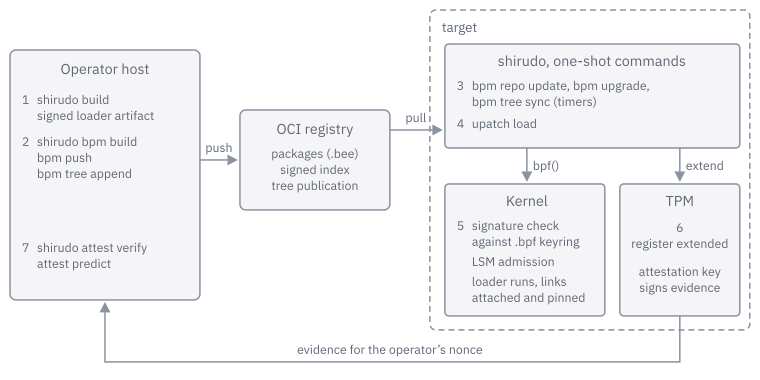

<picture>
  <source media="(prefers-color-scheme: dark)" srcset="Documentation/logos/shirudo-horizontal-for-dark-back.png">
  
</picture>
  

shirudo is a BPF-based security platform for Linux. After boot-time
initialization, it restricts BPF program loads from userspace to signed
loaders. Operators ship signed micropatches, called
[upatches](https://docs.shirudo.dev/upatches/learn/concepts.html),
and verify a target's measured upatch state with TPM-signed evidence.

shirudo (Japanese シールド, pronounced “shee-roo-doh”) means “shield”.

Read the announcements of shirudo on the blogs of
[OpenAI](https://openai.com/index/introducing-shirudo/) and
[Cisco](https://isovalent.com/blog/post/cisco-openai-shirudo/).

## Quickstart

- [Try shirudo in a local VM](https://docs.shirudo.dev/start/quickstart.html).
  The VM uses a software TPM.
- [Read the documentation](https://docs.shirudo.dev/).

shirudo is pre-release. Production targets require a Linux kernel with
the signed-loader ABI and shirudo's kernel patches, plus a TPM 2.0. See the
[system requirements](https://docs.shirudo.dev/operate/plan/system-requirements.html).

CI runs all test tiers on x86-64 and host tests on arm64. The test VM
also boots locally on arm64. Target validation for riscv64 is pending.
The operator and target may use different architectures. See
[architecture support](https://docs.shirudo.dev/contribute/arch-support.html).

## Use cases

- **Runtime security and observability.** Observe process executions,
  network activity, and privilege changes with the included
  [`kernel-obs` package](upatches/kernel-obs/README.md).
- **Live mitigations.** Use BPF upatches to block vulnerable paths at kernel
  hooks or Java upatches to guard application code.
- **System hardening.** Use BPF upatches to enforce policies for
  containers, Kubernetes Pods, and LLM agents.
- **Embedded and edge devices.** Deliver signed mitigations to devices
  with long update cycles.

## Properties

- **Boot-time enforcement.** On production targets, enforcement starts
  when `shirudo init` attaches its guards from the initrd. The guards
  protect shirudo's runtime and state from root on the target without
  the operator's signing key.
- **Signed and sealed BPF.** BPF upatch loads and unloads go through
  loaders that the kernel verifies against the sealed `.bpf` keyring.
- **Signed Java agents.** shirudo verifies Java upatches in userspace.
  Configured JVMs load the agents at startup. See
  [Java agent upatches](https://docs.shirudo.dev/upatches/write/java-agents.html).
- **TPM measurement.** Changes to the loaded upatch set extend a
  per-boot TPM register. `shirudo attest` returns evidence that
  operators can verify offline.
- **Upatches** are small logically contained programs that engineers and
  agents can read, generate and maintain. Commands take and produce
  structured data.
- **Pull-based delivery.** Targets use one-shot commands to pull packages
  from OCI registries and export telemetry to configured OpenTelemetry
  collectors.

The [threat model](https://docs.shirudo.dev/security/threat-model.html)
states where each of these mechanisms stops.

## How it works

BPF upatch lifecycle, from signing through offline verification.
[Follow the numbered steps](https://docs.shirudo.dev/start/how-it-works.html).

## By role

- New to shirudo:
  [FAQ](https://docs.shirudo.dev/start/faq.html)
- Operators, who deploy and run targets:
  [Deployment checklist](https://docs.shirudo.dev/operate/deploy/deployment-checklist.html),
  then [Read shirudo status](https://docs.shirudo.dev/operate/run/read-status.html)
- upatch authors:
  [Your first upatch](https://docs.shirudo.dev/start/guides/first-upatch.html),
  then [From a kernel fix to a upatch](https://docs.shirudo.dev/upatches/learn/kernel-fix-tutorial.html)
- Security reviewers:
  [Security model](https://docs.shirudo.dev/security/security-model.html),
  then [Threat model](https://docs.shirudo.dev/security/threat-model.html)
- Contributors:
  [Develop locally](https://docs.shirudo.dev/contribute/code/develop-locally.html)

## Specifications

- [Beefile](https://docs.shirudo.dev/reference/formats/beefile.html):
  the Beefile that describes a package
- [.upatch format](https://docs.shirudo.dev/reference/formats/upatch-format.html):
  the little-endian container with an architecture-neutral signature
- [upatch tree](https://docs.shirudo.dev/reference/formats/upatch-tree.html):
  the operations, segments and publication document of a upatch tree
- [Keepalive](https://docs.shirudo.dev/reference/formats/keepalive.html):
  the record a target sends its collector, its
  [body](https://docs.shirudo.dev/reference/formats/keepalive.html#keepalive-body-format)
  and its TPM quote

## Releases

[main](https://github.com/shirudo-dev/shirudo/commits/main/) is the
development branch. Development packages are available as run artifacts
from the [Build packages](https://github.com/shirudo-dev/shirudo/actions/workflows/packages.yml)
workflow. Release tags publish their packages on
[GitHub Releases](https://github.com/shirudo-dev/shirudo/releases).

For upgrades of shirudo and the kernel on a target, consult
[Upgrade shirudo and the kernel](https://docs.shirudo.dev/operate/maintain/upgrade.html).

### Software Bill of Materials

Every package comes with a Software Bill of Materials (SBOM) in
[SPDX](https://spdx.dev/) format.

## Project status

 

## License

shirudo is licensed under the [BSD-2-Clause License](LICENSE). BPF
programs are dual-licensed BSD/GPL. Each source file holds an SPDX
license identifier. The tree vendors a few source files from
third-party projects under different but compatible licenses; those
files retain their original SPDX identifier and copyright notices.
